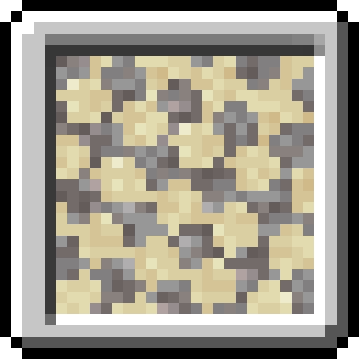

<!-- PROJECT BADGES -->

![Version][version-badge]
[![Stars][stars-badge]][stars-url]
[![License][license-badge]][license-url]

<!-- PROJECT LOGO -->
 

  
  <h3>AvoidSuffocation</h3>
  

    A plugin that automatically avoids suffocation to the side! (axolotl-pm/PocketMine-MP 5.x)

[Contact to me][author-discord] · [Report a bug][issues-url] · [Request a feature][issues-url]

  

<!-- ABOUT THE PROJECT -->

### Overview

Have you ever suffocated because you couldn't find the exit after being buried in sand or gravel?
Now, automatically escape to the side if there is an empty space!

- When a player would take suffocation damage, the plugin looks at the four horizontal neighbours for a spot with two air blocks (feet and head), cancels the damage and pushes the player towards it.
- Does nothing for entities other than players, and when no side is free.
- No commands, permissions or configuration.

---

### Installation & Requirements

- **Server**
  - [axolotl-pm/PocketMine-MP](https://github.com/axolotl-pm/PocketMine-MP) `5.51` or higher (`plugin.yml` `api: [5.51.0]`),
    which uses BedrockProtocol 64 (Bedrock `1.26.60`).
  - PHP `8.4` or higher.
- **Installation**
  - Download `AvoidSuffocation.phar` from [GitHub Releases][releases-url] and place it into your server's `plugins` directory.
  - Restart the server; the plugin will load automatically according to `plugin.yml`.
- **Old versions**
  - The version for the original [pmmp/PocketMine-MP](https://github.com/pmmp/PocketMine-MP) `5.x` (up to `5.44`,
    Poggit releases) is kept on the [`legacy/pmmp-5.44`](https://github.com/presentkim-pm/avoidsuffocation/tree/legacy/pmmp-5.44) branch.
- **Development**
  - `composer install` then `composer test` runs the PHPUnit tests.

---

### License

Distributed under the **LGPL 3.0**. See [LICENSE][license-url] for more information

-----

[author-discord]: https://discordapp.com/users/345772340279508993

[version-badge]: https://img.shields.io/github/v/release/presentkim-pm/avoidsuffocation?display_name=tag&style=for-the-badge&label=VERSION

[release-badge]: https://img.shields.io/github/downloads/presentkim-pm/avoidsuffocation/total?style=for-the-badge&label=GITHUB%20

[stars-badge]: https://img.shields.io/github/stars/presentkim-pm/avoidsuffocation.svg?style=for-the-badge

[license-badge]: https://img.shields.io/github/license/presentkim-pm/avoidsuffocation.svg?style=for-the-badge

[stars-url]: https://github.com/presentkim-pm/avoidsuffocation/stargazers

[releases-url]: https://github.com/presentkim-pm/avoidsuffocation/releases

[issues-url]: https://github.com/presentkim-pm/avoidsuffocation/issues

[license-url]: https://github.com/presentkim-pm/avoidsuffocation/blob/main/LICENSE

[project-icon]: https://raw.githubusercontent.com/presentkim-pm/avoidsuffocation/main/assets/icon.png
